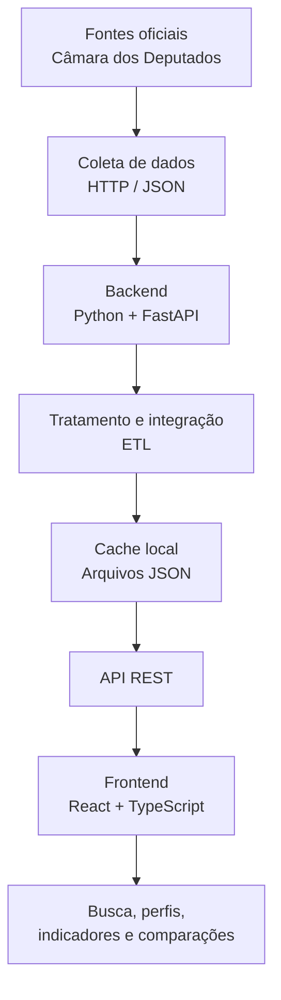

<div align="center">

# Transparência Prática

### Dados públicos mais acessíveis. Informação para uma cidadania mais consciente.

**Plataforma web para integração, análise e visualização de dados sobre a atuação parlamentar brasileira.**

</div>

---

## Visão geral

O **Transparência Prática** é uma aplicação web desenvolvida como Trabalho de Conclusão de Curso de Engenharia da Computação no Centro Universitário Facens. A plataforma reúne informações públicas sobre deputados federais e as apresenta em perfis padronizados, com indicadores e recursos de comparação.

O problema que orienta o projeto é a fragmentação dos dados governamentais: embora as informações estejam disponíveis em fontes oficiais, consultá-las e relacioná-las pode exigir conhecimento técnico e acesso a diferentes sistemas. A aplicação busca reduzir essa barreira, transformando dados brutos em informações organizadas e compreensíveis.

O sistema integra dados cadastrais, despesas parlamentares, proposições legislativas e registros de presença a partir da **API de Dados Abertos da Câmara dos Deputados** e dos arquivos públicos disponibilizados pela instituição.

## O que a aplicação oferece

- **Busca e filtros de parlamentares** por nome, estado, partido e cargo.
- **Perfis individuais** com informações cadastrais e indicadores da atuação parlamentar.
- **Análise de despesas** da Cota para o Exercício da Atividade Parlamentar (CEAP), com consolidação por categoria.
- **Indicadores de produtividade**, incluindo proposições legislativas e registros de presença.
- **Comparação entre parlamentares**, permitindo visualizar métricas lado a lado.
- **Gráficos comparativos** para facilitar a interpretação de gastos e indicadores.
- **Atualização periódica dos dados**, por rotinas executadas em segundo plano.

## Demonstração

> Adicione nesta seção capturas de tela reais da aplicação. Recomenda-se incluir a página inicial, um perfil individual, a tela de comparação e os gráficos analíticos.

<!--
Exemplo, após adicionar as imagens ao repositório:


-->

## Tecnologias

| Camada | Tecnologias |
|---|---|
| Frontend | React, TypeScript, Vite e Tailwind CSS |
| Backend | Python 3.12 e FastAPI |
| Integração | API REST, requisições HTTP e JSON |
| Processamento de dados | ETL, limpeza, padronização e consolidação |
| Cache e persistência local | Arquivos JSON |
| Atualização automática | Agendamento de tarefas em segundo plano |
| Versionamento | Git |

## Arquitetura e fluxo de dados

A solução adota uma arquitetura em camadas, separando a interface, a lógica de processamento e os dados obtidos das fontes oficiais.



### Pipeline ETL

O processamento segue três etapas:

1. **Extract (Extração):** consulta aos endpoints da API da Câmara dos Deputados e aos arquivos JSON públicos de produtividade.
2. **Transform (Transformação):** tratamento, limpeza, padronização e consolidação dos registros coletados.
3. **Load (Carga):** armazenamento local dos dados processados em arquivos JSON e disponibilização para o frontend por meio da API.

O cache utiliza três conjuntos principais de dados:

| Arquivo | Conteúdo |
|---|---|
| `deputados.json` | Dados cadastrais dos parlamentares |
| `gastos.json` | Despesas parlamentares consolidadas |
| `produtividade.json` | Indicadores de produtividade legislativa |

O mecanismo de cache reduz consultas repetidas à API externa e melhora o tempo de resposta da aplicação. As rotinas de atualização são programadas para execução periódica.

## Indicador analítico: Custo por Unidade de Produtividade

Um dos principais objetivos do projeto é relacionar os recursos públicos associados ao mandato com indicadores de atividade legislativa.

De forma conceitual, o indicador é calculado pela relação:

\[
\text{Custo por Unidade de Produtividade} =
\frac{\text{Gastos Públicos}}{\text{Score de Produtividade}}
\]

O score considera variáveis descritas no trabalho, como:

- Quantidade de proposições legislativas;
- Registros de presença em sessões e eventos oficiais;
- Proposições aprovadas.

A métrica permite observar e comparar a relação entre gastos e atividade legislativa. **Ela deve ser interpretada como um indicador quantitativo de apoio à análise, e não como uma medida isolada ou definitiva da qualidade de um mandato.**

## Fontes de dados

Os dados utilizados são provenientes de fontes públicas oficiais da Câmara dos Deputados:

- [API de Dados Abertos da Câmara dos Deputados](https://dadosabertos.camara.leg.br/api/v2)
- [Portal de arquivos de Dados Abertos](https://dadosabertos.camara.leg.br/arquivos/)

Entre os recursos consultados estão os dados de deputados, despesas parlamentares, autoria de proposições e registros de presença em eventos legislativos.

## Como executar localmente

### Pré-requisitos

- Python 3.12 ou superior;
- Node.js e npm;
- Git.

### Configuração do ambiente

Atualmente, o projeto está configurado para execução em ambiente local. O frontend utiliza a variável `VITE_API_URL` para definir o endereço de comunicação com o backend.

O valor utilizado como exemplo é:

```env
VITE_API_URL=http://127.0.0.1:8000
```

### 1. Clone o repositório


```bash
git clone <URL_DO_REPOSITORIO>
cd <PASTA_DO_REPOSITORIO>
```

### 2. Backend

Acesse a pasta do backend — a pasta que contém o arquivo `main.py` e o arquivo `requirements.txt` — e crie um ambiente virtual:

```bash
python -m venv .venv
```

Ative o ambiente virtual:

**Windows (PowerShell):**

```powershell
.venv\Scripts\Activate.ps1
```

**Linux / macOS:**

```bash
source .venv/bin/activate
```

Instale as dependências e inicie a API:

```bash
pip install -r requirements.txt
uvicorn main:app --reload
```

Com a API em execução, a documentação interativa do FastAPI normalmente fica disponível em:

```text
http://localhost:8000/docs
```

### 3. Frontend

Em outro terminal, acesse a pasta que contém o `package.json` do frontend:

```bash
npm install
npm run dev
```

Utilize o endereço local exibido pelo Vite no terminal para abrir a aplicação.

> **Configuração:** confirme no código do frontend o endereço utilizado para acessar a API e ajuste-o para o ambiente local, se necessário. Os comandos acima pressupõem que `main.py` expõe a instância FastAPI como `app` e que os scripts `dev` e as dependências estão definidos no `package.json`.

## Organização do código

O projeto separa responsabilidades entre frontend e backend. No backend, a implementação contempla módulos de coleta, atualização de dados, processamento de produtividade e cálculo de métricas. No frontend, a interface é organizada em páginas e componentes para pesquisa, visualização de perfis e comparação.

> A estrutura exata de diretórios pode variar conforme a versão do repositório. Consulte as pastas do projeto para localizar os arquivos de inicialização e configuração.

## Aprendizados e competências aplicadas

O desenvolvimento do projeto envolveu atividades relacionadas a:

- Integração e consumo de APIs REST;
- Construção de serviços backend com Python e FastAPI;
- Desenvolvimento de interfaces com React e TypeScript;
- Construção de pipeline ETL para dados públicos;
- Tratamento, padronização e consolidação de dados;
- Implementação de cache local em JSON;
- Criação de indicadores e visualizações comparativas;
- Organização de uma aplicação em camadas e módulos.

## Contexto acadêmico

Projeto desenvolvido como **Trabalho de Conclusão de Curso II** do curso de Engenharia da Computação do Centro Universitário Facens, em Sorocaba/SP.

**Equipe**
- Ariane Rossetti
- Gabriel Henrique Cuchera
- Isabela Freire de Góes

**Orientador:** Prof. Marco Antonio Montebello Júnior.

## Observações

- O projeto utiliza dados públicos disponibilizados pela Câmara dos Deputados.
- A atualização e a disponibilidade das informações dependem das fontes oficiais.
- Os indicadores são apresentados para fins informativos e acadêmicos; sua interpretação deve considerar os critérios de cálculo e as limitações dos dados de origem.

---

<div align="center">

**Transparência Prática**  
*Tecnologia e dados a serviço do controle social.*

</div>
